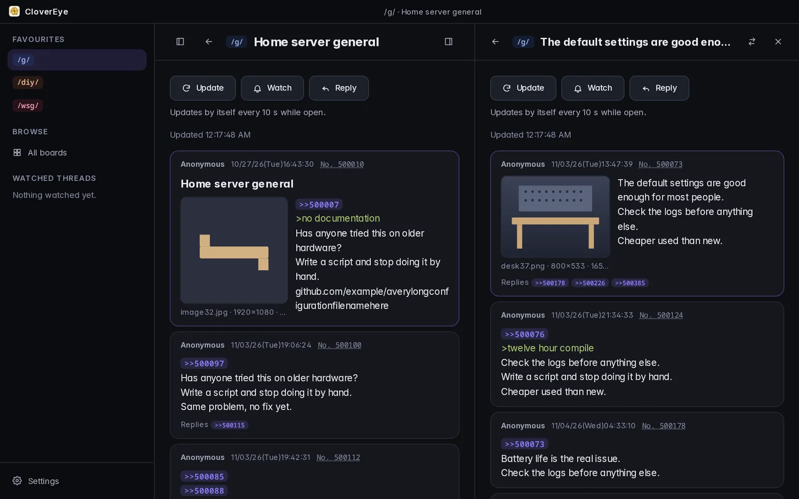
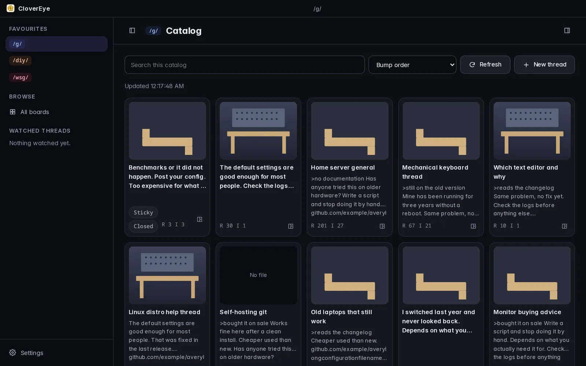
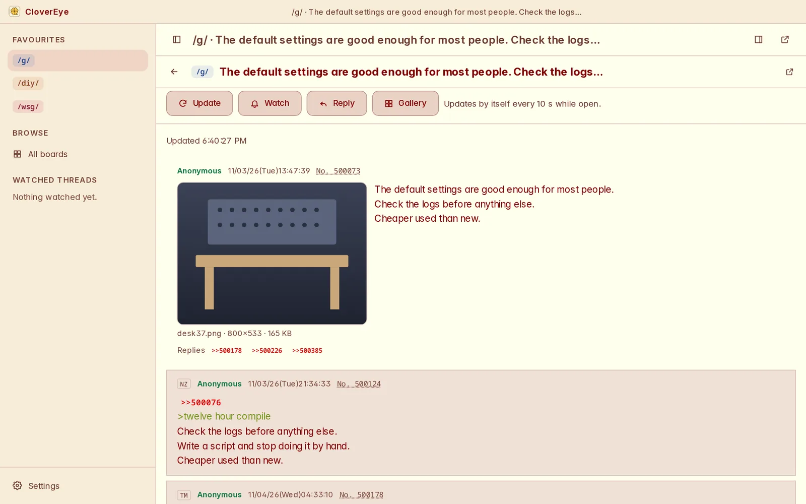
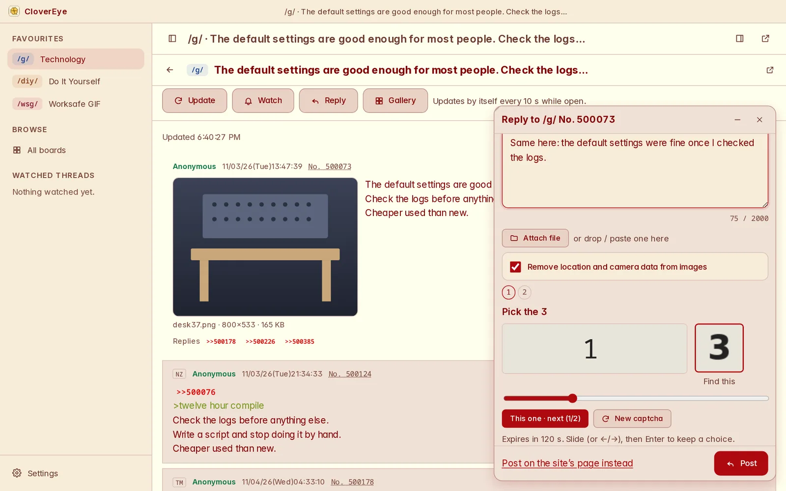
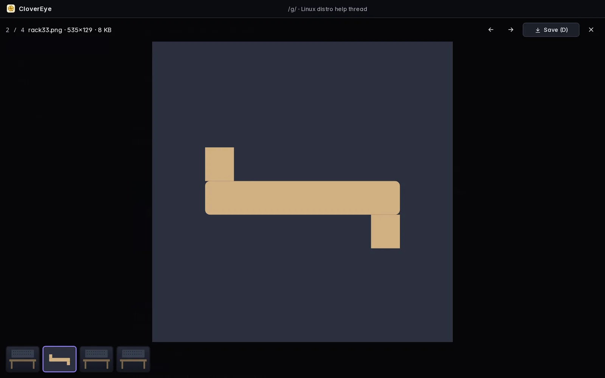

# CloverEye

An **unofficial desktop client for 4chan**: boards and threads in a modern
three-pane layout, a thread watcher, filters, and Clip, which fits a video to
the board you are posting to.

CloverEye is not affiliated with, endorsed by or connected to 4chan. The
site's rules apply to everything read and posted through it.

Licence: [AGPL-3.0](LICENSE). Scope and phases: [docs/SCOPE.md](docs/SCOPE.md).

**Download:** [CloverEye 0.1.1](https://github.com/MiguelCarino/CloverEye/releases/tag/v0.1.1): Fedora 44/45 RPMs, a .deb for Ubuntu 22.04+ and Debian 12+, an AppImage for other Linux, Windows installer and MSI, macOS (Apple silicon). Website: <https://clover.carino.systems>.



| | |
|---|---|
|  |  |
|  |  |

<sub>Screenshots of the app showing sample posts made up for testing.</sub>

## Status: 0.1.1 (reading, watching, panes, gallery, replying)

| Part | State |
|---|---|
| Rust fetch layer (`crates/fetch`) | Built and tested: one queue, ≥ 1 s between requests, ≥ 10 s per thread, `If-Modified-Since`/304, back-off on 429/5xx/other errors that waits out `Retry-After` in full |
| ffmpeg check (`crates/ffcheck`) | Built and tested: read-only `-version`/`-encoders`/`-filters` |
| First-time setup (`ui/`) | Runs in a browser with a mock bridge; 8 steps per SCOPE §3.1b (NSFW is only in Settings). Setup version 2 added Your stats: people who finished version 1 see only that step and Done, once |
| Design tokens (`ui/css/tokens.css`, `themes.css`) | Dark default, light, follows the system; Classic and Atrium theme variants; density; text size |
| Settings (`ui/js/settings-view.js`) | Look (theme, density, text size), Posts (display switches), Replying, Files (download folder, saved threads folder), Content (NSFW boards, 18+ confirmation, embeds), Stats (Track board activity, its boards and interval; Count my own activity; Delete my stats), Reverse image search, Archives, Filters, Setup and About; saves as you change it. While NSFW boards are off, their archive choices and saved threads are not listed |
| Desktop shell (`src-tauri/`) | Release-built and packaged (Fedora 44/45 RPMs, AppImage); runs on Fedora 45 with the live site |
| Reading (`ui/js/browse.js`, `browse-model.js`) | Board list, catalog (search, sort, refresh) and threads (backlinks, files expand in place, WebM plays inline, updates itself every 10 s or more while open, stops on closed/archived/404) through `fetch_catalog`/`fetch_thread` and the one queue; thumbnails and files load in the webview from the image host. F5, Ctrl+R and ⌘R (with or without Shift) update the focused pane instead of reloading the window. Checked against the live /g/ catalog and a live thread on 4 November 2026 |
| Video | WebM and MP4 play inline (one at a time, volume remembered for the session) and keep playing through thread updates; checked live on /wsg/ in WebKitGTK on 5 November 2026 |
| Hover preview (`ui/js/hover.js`) | Resting the mouse on a thumbnail shows the full image, or plays the video muted, fitted inside the window; Settings → Look turns it off |
| Quote links (`ui/js/quotes.js`, `quote-model.js`) | Clicking a `>>123` quote or a backlink opens that post right below the link, indented; clicking again closes it. Copies nest to any depth, but a post never opens inside itself (the link then points at the open copy). Open copies stay open through thread updates. Ctrl/⌘-click jumps to the post instead; Settings → Look → Quote links makes jumping the default (Ctrl/⌘ then opens inline). Resting the mouse on a link, or tabbing to it, shows the post in a floating preview beside the link, never over it (Esc, scrolling or clicking hides it, and that Esc does nothing else; Settings → Look turns it off). A quote of a post the thread no longer has shows “Post not found”. Quotes of another thread's post (`>>>/g/123`, or `>>123` whose address is another thread) preview and open inline the same way: that thread is fetched through the one queue (never more often than every 10 s; kept 60 s, 40 threads at most, this session only), “Loading…” first, then the post, or “Post not found”, “This thread is gone (404).” or a failure with Try again, each with Open in archive. Jumping (Ctrl/⌘-click, or the Jump setting) opens that thread beside, scrolled to the post |
| Panes and windows | Up to five panes per window, in one to three rows (the 1/2/3 switch); open a thread beside (the card's button, Ctrl+click, middle-click); each pane can move to a window of its own, which has its own five panes. Windows share one request queue and one settings file (a change in one reaches the others). On a narrow window, tabs switch panes |
| Thread controls and flags | A thread's Update, Watch, Reply and Gallery stay at the top of the pane: scrolling down tucks them away, scrolling up, reaching the end, pointing at the top of the pane or tabbing to them brings them back. Posts show the poster's flag (country flags on /int/, /bant/, /sp/ …; board flags where a board has its own), with its name on hover |
| Languages and version | English, Spanish, Portuguese (Brazil), Japanese and Russian (Settings → Language; “Same as the system” by default). The English text is the key (`ui/i18n/<code>.json`); `ui/js/i18n.js` translates what is drawn and never what comes from the site (posts, names, titles, file names carry `translate="no"`). `node tools/i18n-strings.mjs --missing` lists strings a language lacks; `tests/i18n.test.mjs` fails on any. Settings → About shows the version (`ui/js/version.js`, kept equal to Cargo.toml) |
| Debugging the posting helper | Run from a terminal with `CLOVEREYE_HELPER_DEBUG=1`: the helper window and every frame in it (the captcha frame, Cloudflare's, the site's abuse-check services) report what they load, what fails, their console errors and the engine's features. `CLOVEREYE_CAPTCHA_PAGE=1` opens the captcha page itself at once; `CLOVEREYE_TRY_CAPTCHA=g/123` asks for one captcha at start and `CLOVEREYE_TRY_CAPTCHA_FILE=path` saves the answer. Packaging: `packaging/build-rpm.sh`, `build-in-container.sh 44`, `build-appimage.sh`, `build-deb.sh` (Ubuntu 22.04 container, depends on the system's WebKitGTK 4.1) |
| Archive links (`ui/js/archive-model.js`) | A built-in, hand-kept list of third-party archives (desuarchive.org, archive.4plebs.org, warosu.org, arch.b4k.dev, thebarchive.com, archiveofsins.com, archive.palanq.win, archived.moe) and the boards each keeps. Dead quote links get a small button to the post on the board's archive; a quote of a thread that is gone, a thread pane that 404s and an archived thread get “Open in archive (host)”. Links open in the system browser (the desktop app may open only these hosts); nothing is fetched from an archive. Settings → Archives turns them off, or picks the archive (or Off) per board; by default the first archive that keeps the board |
| Gallery | **G** in a thread: every file, one at a time, as large as the window allows; ←/→, J/K, Home/End or the mouse wheel move, **D** saves (Settings → Files folder, else Downloads/CloverEye; the button shows the download running and landing, and saved files get a check in the strip), Esc or G closes |
| Saved threads and Download all (`ui/js/offline-model.js`, `offline.js`, `src-tauri/src/offline.rs`) | A thread's Save offline writes the thread as already loaded through the queue (no extra API request) and its files and thumbnails to Settings → Files → Saved threads folder (default Downloads/CloverEye/Saved threads): `<board>-<no>-<slug>/thread.json`, `files/<tim><ext>`, `thumbs/<tim>s.jpg`, plus `index.json`. Thumbnails first, then files, one at a time and ≥ 1 s apart (enforced in Rust too), with “Saving 12/48 files…” and Cancel in the toolbar; files already there are skipped without a request, so running it again (Update saved copy) fetches only new posts' files, and posts the site has dropped stay in the copy. Five failures in a row stop the run. The rail's Saved threads (and All saved threads: title, board, date, files, size) open a copy read-only from disk: images, videos and the gallery work with no network (flags show as their code, embeds and reverse search are off, other threads' quotes are not previewed; clicking one opens that thread live beside); Delete asks first. Saved files reach the page only through the app's own `cesaved:` scheme, which serves `files/` and `thumbs/` of saved threads to CloverEye's windows only (byte ranges for videos; CSP img-src/media-src gain only that scheme), not Tauri's asset protocol, whose scope would be the whole chosen folder. Rust checks every part (board `^[a-z0-9]{1,10}$`, numbers, extension list, no links out, nothing outside the folder). Download all puts every file under its original name in the download folder through the same ≥ 1 s gate, skipping one already there at its size. Never a whole board. **Not yet checked in the desktop app** (built and unit-tested; the browser mock simulates saving) |
| Display switches (`ui/js/display-model.js`) | Settings → Posts. Timestamps: Local time (default; the post's time in the UI's language and the computer's zone, the site's text on hover), Relative (“3 min ago”, its text set again every minute without redrawing the thread; the full time on hover) or Board time (the site's own text). Reveal spoilers (off by default: a spoilered file is a blank “Spoiler” box with no hover preview until clicked, in threads and the catalog; on: the real thumbnail, and spoiler text shown with a dotted underline instead of the black bar). Hide images, work mode: each file is one line with its name, size and dimensions, clicking it shows that one file (kept through updates this session); catalog cards show “File hidden”. Expand images in threads (off by default): images, never videos or other files, open in place as the thread is drawn, lazily, fitted like the hover preview (the pane's width, the window's height less 24 px, never past the file's own size); one closed by hand stays closed this session. Gallery preloads the next and previous images (on by default; videos never; from the image host only, no API requests). Anonymize names: every name and tripcode reads Anonymous (IDs, flags and capcodes stay); filters and the post menu still use the real ones |
| Sidebar | Hide or show it from the button left of the title; remembered |
| Favourites | Star boards in All boards |
| Thread watcher | Watch from a thread; the rail lists watched threads with unread counts, 404 and archived marks; polled at the watch interval through the same queue (open threads update themselves). Replies to your posts are tinted and counted (thread toolbar, and a second badge in the rail). Notifications are not built yet |
| Filters (`ui/js/filter-model.js`, `filters-view.js`) | Plain text or a regular expression on comment, subject, name, tripcode, poster ID, file name or file MD5; every board or some; hide or highlight. Applied to catalog threads (a line counts the hidden ones and shows them) and to posts (a hidden post leaves a one-line stub, “Hidden post No. N · why”, that shows it once when clicked; posts hidden by hand also get Unhide). Replies whose quotes are all hidden posts are hidden too, down the chain (`ui/js/hide-model.js`; Settings → Filters → “Also hide replies to hidden posts”, on by default; your own posts and quotes of the OP never count). Settings → Filters adds, edits, switches off and removes them, checks patterns as they are typed (a bad regex or one matching empty text is refused), exports JSON to copy and imports pasted JSON. Each post's … menu hides it or filters its name, tripcode, ID or file (MD5) on that board; catalog cards have a hide button (off, with “Hidden by a filter”, on a thread a filter hides; unhiding something a filter still hides says so). Hidden-by-hand posts and threads are kept in settings (1000 at most). Filters take at most about 96 KB of the settings file; past that a new one is refused (“The filter list is full”). Settings are kept under the 256 KiB the app stores: the oldest read marks go first, then the oldest hidden posts, then the oldest (You)s |
| Poster IDs and unread (`ui/js/ids-model.js`, `unread-model.js`) | On boards with poster IDs, each ID has a colour made from it (black or white text, whichever reads better; Settings → Look turns the colours off) and the number of posts it has in the thread, “ID: abcd1234 (3)”. Clicking an ID highlights that poster's posts; clicking it again, the toolbar's pill or Esc clears it. Each thread remembers the last post that was on screen (500 threads at most, kept in settings; a watched thread's unread count follows it). A “New posts” line sits above the first post after it when the thread is opened again, and moves above the new posts of an update once everything before them was read. **U** or the toolbar's First unread (off when nothing is unread) jumps to the first unread post; the window title starts with the focused thread's unread count, “(3) /g/ · title · CloverEye”. Hidden posts and your own never count. Only read while the window has the focus; other windows update their counts for it without redrawing. No tray icon yet, so no count there |
| Posting (`post_agent`, `src/post_agent.js`) | Reply, quote (a post's No.) and New thread open CloverEye's own reply form: name, options, subject, comment with the board's limit, a file (pick, drop or paste; location and camera data stripped from JPEG/PNG first), spoiler, checks against `boards.json` before sending, the site's captcha shown and solved in the form, (You)s remembered and the thread watched. The form resizes from the grip in its top-left corner (drag, or arrow keys on the grip; double-click for the default size; the size is kept). The form minimises to its title bar (which shows a wait counting down, or what the captcha needs), and drafts are saved as they are typed, so they come back after the app is closed (the text only, not the attached file). Selecting text in a post and pressing its No. quotes it: `>>N`, then the selection as greentext (`> line`), at the caret when the form is already open. Settings → Replying → Random file names (off by default; the form has a Random name switch beside the file, for that post) sends the file as a 13-digit number plus its extension, like 4chan X; the file's own name shows greyed. A wait the site asks for counts down live, and the next captcha comes by itself when it ends. The site's captcha and post endpoints sit behind a Cloudflare check that refuses a plain client (403), so a hidden helper window on the site's own page does what the site's form does; when the site wants its human check (the captcha frame stays silent for a few seconds), that window opens the captcha page as its own page, where the check works as Cloudflare intends, and comes forward for the person to pass; the captcha then lands in the form and the window hides. Closing that window ends the wait with a message. A captcha that has not come after 7 s brings the window forward regardless, and the form has a “Show the site window” button. If the helper's web page dies, the form says so and the page reloads. Helper steps are logged to the terminal (`clovereye post helper: …`); `CLOVEREYE_TRY_CAPTCHA=<board>` asks for one captcha at start and prints what came back (it never posts). The AppImage leaves colour fonts out (its bundled WebKit aborts on COLRv1 colour fonts such as Fedora's emoji), so emoji are black and white there; `CLOVEREYE_COLOR_FONTS=1` keeps them. **Not yet tested with a real post**; the human check was seen live but not passed by the tests. When the site asks for hCaptcha, “Post on the site's page instead” opens the site itself |
| Stats pane (`ui/js/stats-model.js`, `my-stats-model.js`, `stats.js`, `stats-view.js`, `src-tauri/src/stats.rs`) | Browse → Stats, like 4stats.io: for each board followed (the favourites, or every worksafe or every visible board; boards with samples are listed too, never NSFW ones while those are off) the posts a minute now (from the rise in the board's highest post number between two samples), averages over the last hour and 24 h once samples cover enough of them, threads an hour (new opening posts between samples), live threads, the busiest thread now (most replies gained since the sample before; opens on click) and a 24-hour sparkline. Sortable by board, posts a minute and threads an hour; “Collecting… (needs two samples)” until a rate exists; each board's last sample time. Every catalog the app loads anyway is a sample (no extra request); with Track board activity off, those samples stay in the window's memory and are never written to disk. Settings → Stats → Track board activity (off by default) samples in the main window only, through the same queue: one board at a time, only when no API request is waiting or under way in any window (`fetch_busy`), ≥ 10 s after its last sample, each board at most every 5, 10, 15 or 30 min (default 5), paused once the window has been hidden longer than that; the pane says what it is doing. F5/Ctrl+R/⌘R in the pane samples each listed board whose last sample is over a minute old. Samples are compact (time, highest No., live threads, new threads, busiest thread), kept 24 h and under 3 MiB, in `stats-boards.json` in the app's data folder (`stats_read`/`stats_write`, written atomically with a revision check so windows never overwrite each other), never in settings. **You** (Settings → Stats → Count my own activity, or the setup step; off by default, local only): per day for 90 days, time with a window focused and visible, threads opened, posts read (newly marked read), posts made, replies to you (each once), files viewed (gallery, click-to-open, hover preview), threads saved offline, and time and threads per board; today, 7 and 30 days, a per-day bar chart and top boards, in `stats-mine.json`; Delete my stats asks first. Off, nothing is counted |
| Thread stats and reverse image search (`ui/js/stats-model.js`, `sauce-model.js`) | The thread toolbar shows replies, files and posters (the OP's counts and `unique_ips`, else counted from the thread and its poster IDs) and the thread's page in the board's catalog, “Page 3 of 10”, when that catalog is already loaded (never fetched for this; the page's tooltip says when it was loaded). The last page, the bump limit and the image limit show in the warning colour. Each file has a Search menu: SauceNAO, Google Lens, Yandex and IQDB by default, TinEye and trace.moe in Settings → Reverse image search (none ticked: no menu). The search gets the file's address on the image host (a video's, PDF's or other non-picture's thumbnail), opens in the system browser, and nothing is sent before a site is picked; the desktop app may open only those six search addresses |
| Links and embeds (`ui/js/link-model.js`, `embeds.js`) | Web addresses in post text become links (http and https; a bare `www.…` or `domain.tld/…` is taken as https; trailing punctuation left out, addresses broken by `<wbr>` joined, nothing glued to a word or an e-mail address, no `user:password@`). They open in the system browser through `open_link`, which accepts http and https only; the opener's own list of hosts is unchanged. YouTube (watch, youtu.be, shorts, embed, live; start time kept), Vimeo, Streamable and SoundCloud links get an Embed button that plays them in one player docked in the window's lower-left corner, outside the panes, so thread updates never reload it (Esc or × closes it; ↗ opens the page in the browser). Nothing loads from those sites before the click. YouTube plays from `youtube-nocookie.com`, Vimeo with `dnt=1`; frames are sandboxed (scripts, same origin, fullscreen: no pop-ups, no navigating the app). The CSP gains only `frame-src 'self'` plus those four player hosts. Twitter/X stays a link (its embed needs the site's script in the page). Settings → Content → Embeds: Off or Click to load (default). **Not yet checked in the desktop app**: YouTube may refuse to play in a page served from the app's own scheme (its player wants a web referrer); the player's ↗ then opens it in the browser |
| Logo and start-up | An oekaki-style golden clover; a short start-up animation (skipped with reduced motion) |
| Live API probe (`crates/fetch/examples/probe.rs`) | Run once on 4 November 2026: no 429s; results in [docs/C0-PROBE.md](docs/C0-PROBE.md) |

Not done yet (C0 gates in SCOPE §7): the week of normal browsing with zero
429s, WebM playback in WebKitGTK and WKWebView, and the hand-posted
codec/MP4/dimension checks.

## Layout

```
crates/fetch      clovereye-fetch: queue, limits, cache, back-off, API models
crates/ffcheck    clovereye-ffcheck: what the local ffmpeg can do for Clip
ui/               the app's UI: plain HTML/CSS/JS, no build step, no CDN
  js/setup-model.js   setup rules, DOM-free (tested with node --test)
  js/bridge.js        Tauri invoke inside the app, a mock in a browser
src-tauri/        Tauri 2 shell (excluded from the root Cargo workspace)
tests/            node tests for ui/
```

## Build dependencies (Linux, Fedora 44 and 45)

The Rust crates and the UI need only Rust and Node. The desktop shell also
needs the WebKitGTK and GTK 3 development files. Install them yourself; the
project never runs a package manager:

```sh
sudo dnf install webkit2gtk4.1-devel gtk3-devel libsoup3-devel librsvg2-devel
```

Package names checked against Fedora 44 and Fedora 45 with
`dnf repoquery --whatprovides 'pkgconfig(webkit2gtk-4.1)'` (and the same for
`gtk+-3.0`, `libsoup-3.0`, `librsvg-2.0`). `javascriptcoregtk4.1-devel`
comes in as a dependency of `webkit2gtk4.1-devel`. TLS uses rustls, so
`openssl-devel` is not needed.

Toolchain used: Rust 1.99 (Fedora's), Node 22, and the Tauri CLI only for
bundling (`cargo install tauri-cli --version '^2'`), which C0 does not need.

## Tests

```sh
CARGO_BUILD_JOBS=4 cargo test     # Rust: fetch limits, models, ffmpeg parsing
node --test tests/*.test.mjs      # UI: setup model, bridge, comment parser, static checks
```

All automated tests use recorded fixtures and a fake clock; none touches the
network. The fixtures and how they were recorded are listed in
`crates/fetch/tests/fixtures/SOURCE.txt` (two GETs, three seconds apart).

## Run the UI in a browser

ES modules need a server (not `file://`):

```sh
python3 -m http.server 7397 --bind 127.0.0.1 --directory ui
# open http://127.0.0.1:7397/
```

In a browser the bridge is a mock and never contacts the site: every board
shows the synthetic catalog in `ui/data/catalog.sample.json`, threads are
built from it, and files show local pictures. Settings live in `localStorage`, the board
list comes from the recorded `ui/data/boards.sample.json`, and the ffmpeg
check returns a canned result matching the Fedora 45 machine CloverEye is
built on. Query parameters exercise the other states:

| Parameter | Effect |
|---|---|
| `?mock-boards=fail` / `fail-once` | Board list fails (always / first try only): Retry and Skip |
| `?mock-catalog=fail` | Every catalog fails: the error and Try again |
| `?mock-grow` | Every later fetch of a thread adds one reply (for the watcher) |
| `?mock-cross` | Every thread gets one more reply quoting another thread's post, a thread that is gone and a dead post |
| `?mock-links` | Every thread gets one more reply with web addresses: YouTube, Vimeo, Streamable and SoundCloud (Embed), X, one split by `<wbr>`, one in a spoiler, and ones that must stay text |
| `?mock-captcha=wait` / `none` | The captcha asks to wait, or is not needed. The mock captcha's right answer is the 3rd choice, then the 2nd |
| `?mock-save=fail` | Save offline fails every full file (thumbnails pass), to see the run stop after five failures |
| `?mock-stats` | Seeds a day of board samples (every 5 min for /g/ /v/ /a/ /tv/ /diy/ /sci/ /ck/ /fit/, with a two-hour gap on /tv/) and 30 days of your own counts, when there is little stored. The mock catalog always moves with the clock (each board its own pace, new threads, one busy thread), so rates appear without it too |
| `?mock-ffmpeg=missing` / `partial` / `no-vp9` | ffmpeg absent, optional extras missing, or VP9 missing |
| `?mock-delay=0` | No artificial delay |
| `#setup` | Run setup again after it was finished |

To start over, clear the site data for `127.0.0.1:7397`.

### Browser checks (Playwright)

With the server above running, two scripts drive the UI. Playwright is not a
dependency of this repo; point `PLAYWRIGHT` at an installed copy's
`index.mjs`.

```sh
PLAYWRIGHT=/path/to/playwright/index.mjs node tests/e2e/setup-flow.mjs chromium   # or firefox
PLAYWRIGHT=/path/to/playwright/index.mjs SHOTS_DIR=shots node tests/e2e/layout.mjs chromium
```

`setup-flow.mjs` walks all seven steps and Settings with the mouse and
again with the keyboard only (Enter, Esc, arrows, Tab, Space), plus the
board-list failure and missing-ffmpeg states. `layout.mjs` screenshots every step, the dialogs
the shell and Settings (with a few Classic and Atrium themes) at widths
360, 800, 1280 and 1920 in dark and light, and
reports horizontal scroll, off-screen or clipped elements, overlapping
controls and console errors.

## Run the desktop shell

```sh
cd src-tauri
CARGO_BUILD_JOBS=4 cargo run
```

Notes for the first test builds:

- The release build was launched once on Fedora 45 (4 November 2026): the
  window opens with the custom title bar and the setup's first step renders
  with its fonts and icon. Not checked yet: the window controls on the title
  bar, the `ipc:` connection under the page's own CSP (`ui/index.html`
  carries a meta CSP as well as `tauri.conf.json`; if the IPC is blocked,
  drop the meta tag), and that the rules link opens in the system browser.
- `capabilities/default.json` allows only the four app commands
  (`get_settings`, `set_settings`, `check_ffmpeg`, `fetch_boards`), the
  title-bar window controls, and opening `https://www.4chan.org/rules`.
- The CSP's `frame-src` allows `'self'` and the four embed players
  (`www.youtube-nocookie.com`, `player.vimeo.com`, `streamable.com`,
  `w.soundcloud.com`); a frame is created only when Embed is clicked.
- Settings are JSON in the app config folder for now (SQLite comes in C1).

## Packages

Test builds are attached to the GitHub releases:

```sh
sudo dnf install ./clovereye-0.1.1-1.fc45.x86_64.rpm   # Fedora 45 (or .fc44)
chmod +x CloverEye-0.1.1-x86_64.AppImage && ./CloverEye-0.1.1-x86_64.AppImage   # other x86-64 Linux
```

`CloverEye-0.1.1-appimage-sources.tar` next to it is the Corresponding Source
for the AppImage: CloverEye's own source and the Ubuntu 22.04 source package
of every library it bundles (WebKitGTK, GTK 3, GStreamer and their
dependencies, LGPL and others), traced file by file (`files.tsv` inside).

The AppImage is built on Ubuntu 22.04 and needs glibc 2.35 or newer. It
carries its own WebKitGTK and GStreamer (base and good plugins, which
include the WebM demuxer and VP8/VP9 decoders); WebM playback in it is not
tested yet.

To build them yourself, see [Building releases](#building-releases).

## Building releases

Every platform builds the same thing: the Tauri shell in `src-tauri/` with the
UI in `ui/` embedded (no dev server). Release files follow one naming scheme,
and each GitHub release carries a `SHA256SUMS` covering all of them.

| Platform | Where it is built | Command | Release file |
|---|---|---|---|
| Fedora (host release) | a Fedora machine | `packaging/build-rpm.sh` | `clovereye-<v>-1.fc<N>.<arch>.rpm` |
| Fedora (other release or arch) | Linux or a Mac with podman | `packaging/build-in-container.sh <N>` | `clovereye-<v>-1.fc<N>.<arch>.rpm` (x86_64, aarch64) |
| Ubuntu 22.04+ / Debian 12+ | any Linux with podman | `packaging/build-deb.sh` | `clovereye_<v>_amd64.deb` |
| Other Linux | Linux or a Mac with podman | `packaging/build-appimage.sh` | `CloverEye-<v>-x86_64.AppImage` + `CloverEye-<v>-appimage-sources.tar` |
| Windows | GitHub Actions (`windows.yml`) | push a `v*` tag, or run it by hand | `CloverEye-<v>-x64-setup.exe`, `CloverEye-<v>-x64.msi` |
| macOS (Apple silicon) | a Mac | `cargo tauri build --bundles app,dmg` | `CloverEye-<v>-aarch64.dmg` |
| macOS (Intel) | an Apple silicon Mac, with the official Rust toolchain | `cargo tauri build --target x86_64-apple-darwin --bundles app,dmg` | `CloverEye-<v>-x86_64.dmg` |

The Linux scripts write to `~/.cache/clovereye/packaging` (or the folder given
as their last argument), never into the repository.

### 1. Set the version

A version lives in five places; change them together and commit before
building, so every platform builds the same commit:

- `src-tauri/Cargo.toml` (`version = "…"`), then `cargo update -p clovereye --manifest-path src-tauri/Cargo.toml` to refresh `src-tauri/Cargo.lock`
- `src-tauri/tauri.conf.json` (`"version"`)
- `ui/js/version.js` (`VERSION`, shown in Settings)
- `tests/e2e/setup-flow.mjs` (the Settings version check)
- `packaging/clovereye.spec`: a new `%changelog` entry, `<v>-1`

The package scripts read the version from `src-tauri/Cargo.toml`. Run the
tests (see [Tests](#tests)) before building.

### 2. Linux

Needs podman for everything except the host's own RPM, which needs the
[build dependencies](#build-dependencies-linux-fedora-44-and-45) and
`rpm-build`.

```sh
packaging/build-rpm.sh                 # RPM for the Fedora release you are on
packaging/build-in-container.sh 44     # RPM for another release (here Fedora 44), in a container
packaging/build-deb.sh                 # .deb, in an Ubuntu 22.04 container
packaging/build-appimage.sh            # AppImage + its sources tar, in an Ubuntu 22.04 container
```

`PLATFORM` picks the container's architecture, and so the RPM's. On an Apple
silicon Mac (podman machine with Rosetta enabled):

```sh
PLATFORM=linux/arm64 packaging/build-in-container.sh 44   # aarch64 RPM, native, ~3 min
PLATFORM=linux/amd64 packaging/build-in-container.sh 44   # x86_64 RPM, emulated, ~8 min
PLATFORM=linux/amd64 packaging/build-appimage.sh          # the AppImage is x86_64 only
```

On an x86_64 Linux host, `PLATFORM=linux/arm64` needs qemu-user-static. If
`archive.ubuntu.com` is unreachable, `UBUNTU_MIRROR=http://us.archive.ubuntu.com`
points the AppImage build at one of Canonical's country mirrors,
which carry the same packages, source packages included.

`build-rpm.sh` makes the same release build as `cargo tauri build` and
packages it with `packaging/clovereye.spec`. The RPM recommends
`/usr/bin/ffmpeg`, so Fedora's `ffmpeg-free` and RPM Fusion's `ffmpeg` both
satisfy it. The containers copy the working tree in (uncommitted edits
included), so build from a clean checkout of the release commit. The `.deb`
and the AppImage link against Ubuntu 22.04, so they run on glibc 2.35 and
newer. The AppImage's sources tar is its Corresponding Source and ships with
every AppImage; `--no-sources` is for quick local rebuilds only.

### 3. Windows

Built on a GitHub Windows runner by `.github/workflows/windows.yml`, which
runs the Rust tests and makes an NSIS installer and an MSI (both install
WebView2 if it is missing). It runs when a `v*` tag is pushed, or by hand
from Actions → Windows → Run workflow. The installers are the run's
artifact, `clovereye-windows`, already named for the release:

```sh
git tag v<v> && git push origin v<v>
gh run list --workflow Windows -L 1                        # wait for it to finish
gh run download <run-id> -n clovereye-windows -D out/
```

To build on a Windows machine instead: install Rust (MSVC toolchain) and the
Tauri CLI (`cargo install tauri-cli --version '^2' --locked`), then
`cd src-tauri` and `cargo tauri build --bundles nsis,msi`. The installers
land in `src-tauri/target/release/bundle/nsis/` and `bundle/msi/`; rename
them as in the table.

### 4. macOS

Built on a Mac with the Xcode Command Line Tools (`xcode-select --install`),
Rust, and the Tauri CLI (`cargo install tauri-cli --version '^2' --locked`).
No other libraries: the app uses the system WebKit.

```sh
cd src-tauri
cargo tauri build --bundles app,dmg
cp target/release/bundle/dmg/CloverEye_<v>_aarch64.dmg ../out/CloverEye-<v>-aarch64.dmg
```

That builds for the Mac's own architecture (Apple silicon here). The Intel
build (0.1.2 and later) is cross-built on the same Mac, but not with
Homebrew's Rust: Homebrew builds its own standard library, and it has none for
`x86_64-apple-darwin` (the official one is refused, since its compiler reports
a different version string). Use the official toolchain instead, from rustup
(`rustup target add x86_64-apple-darwin`) or unpacked into a folder of its
own. The official tarballs are on static.rust-lang.org, each with a `.sha256`:
`rust-<rust>-aarch64-apple-darwin.tar.xz` for the compiler and
`rust-std-<rust>-x86_64-apple-darwin.tar.xz` for the Intel library.

```sh
# once: official Rust in ~/.cache/clovereye/rust-<rust>, Homebrew untouched
P=~/.cache/clovereye/rust-<rust>
sh rust-<rust>-aarch64-apple-darwin/install.sh --prefix=$P --components=rustc,cargo,rust-std-aarch64-apple-darwin --disable-ldconfig
sh rust-std-<rust>-x86_64-apple-darwin/install.sh --prefix=$P --disable-ldconfig

cd src-tauri
PATH=$P/bin:$PATH cargo tauri build --target x86_64-apple-darwin --bundles app,dmg
cp target/x86_64-apple-darwin/release/bundle/dmg/CloverEye_<v>_x64.dmg ../out/CloverEye-<v>-x86_64.dmg
```

`lipo -archs` on `CloverEye.app/Contents/MacOS/clovereye` should print
`x86_64`; on an Apple silicon Mac the app also runs under Rosetta, a quick
check that it starts. Both dmgs need macOS 10.13 or later.

The macOS bundle uses its own icon, `icons/macos/icon.icns` (set in
`tauri.macos.conf.json`), made from `icons/macos/icon.svg`: the logo as an
824 px tile on a 1024 px canvas, Apple's icon grid. macOS 26 and later put an
icon that fills its whole canvas on a system tile, dark in dark mode. To
remake it after the logo changes:

```sh
mkdir icon.iconset
for p in 16 32 128 256 512; do
  rsvg-convert -w $p -h $p src-tauri/icons/macos/icon.svg -o icon.iconset/icon_${p}x${p}.png
  rsvg-convert -w $((p*2)) -h $((p*2)) src-tauri/icons/macos/icon.svg -o icon.iconset/icon_${p}x${p}@2x.png
done
iconutil -c icns icon.iconset -o src-tauri/icons/macos/icon.icns
```

The app is ad-hoc signed and not notarised, so the first launch
needs right-click → Open (or System Settings → Privacy & Security → Open
Anyway). `codesign --verify` reports "code has no resources but signature
indicates they must be present" for this ad-hoc signature; every release so
far has done the same.

### 5. Publish

Put every file for the release in one folder, write the checksums, and
attach them. A test build goes out as a pre-release, so the website and the
"Latest" release stay on the last stable version:

```sh
cd out/
shasum -a 256 clovereye-<v>-* clovereye_<v>_* CloverEye-<v>-* > SHA256SUMS   # sha256sum on Linux
gh release create v<v> --prerelease --title "CloverEye <v> (test build)" ./*
gh release upload v<v> <file>… SHA256SUMS --clobber   # adding files to an existing release
```

`gh release upload --clobber` replaces a file of the same name, so upload
the rewritten `SHA256SUMS` along with any file added later. Check the result
by downloading it again and running `shasum -a 256 -c SHA256SUMS`. When a
version becomes the stable one, mark it Latest and update the download links
in `index.html` and at the top of this README.

## Live API probe (C0 gate)

```sh
cargo run -p clovereye-fetch --example probe -- --out results/probe.md
```

At most 8 requests (25 allowed), one queue, ≥ 1 s apart, honest
`User-Agent: CloverEye/0.1.0`: boards, `/g/` catalog twice (the second
conditional), `threads.json`, one live thread twice ≥ 10 s apart, and
`archive.json`. `--thumb` adds one thumbnail request to see whether the
image host answers a polite client or returns 429.

## Rules the client keeps

- At most one request per second for the whole app; thread updates no more
  often than every 10 s; `If-Modified-Since` on every repeat request
  (4chan's published API rules). These are hard limits, not settings.
- Back-off on 429, 5xx, other unexpected statuses (403, 3xx) and network
  errors. A server's `Retry-After` is waited in full (only values over 24 h
  are cut); without one the delay doubles from 2 s, capped at five minutes.
- Redirects are not followed, so no request skips the queue.
- `User-Agent: CloverEye/<version>`. Nothing about the user is sent.
- NSFW boards (`ws_board: 0`) stay hidden until the user opts in, in
  Settings → Content, with an explicit 18+ confirmation. Setup never asks.
- No package manager is ever run and no admin rights are asked for; missing
  tools come with a command to copy.

## Third-party files

- Inter (variable), © The Inter Project Authors, SIL OFL 1.1:
  `ui/fonts/Inter-OFL.txt`
- Noto Sans Mono (variable), © The Noto Project Authors, SIL OFL 1.1:
  `ui/fonts/NotoSansMono-OFL.txt`

Both are subset to Latin, Greek and Cyrillic and converted to WOFF2.
